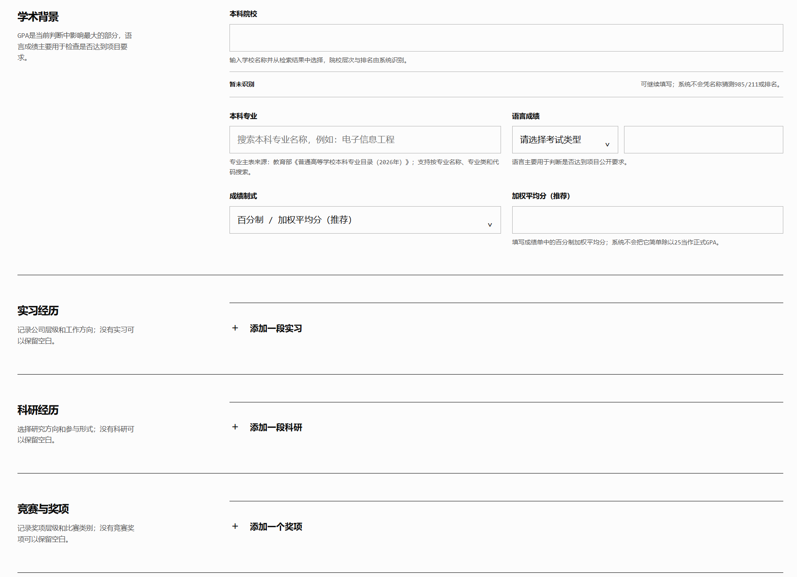
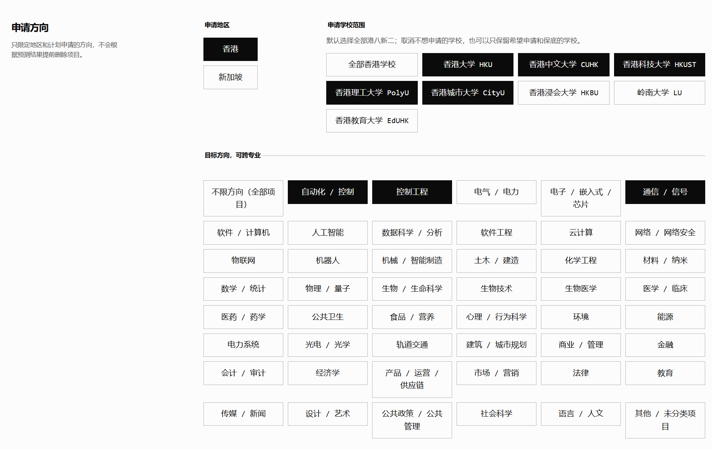
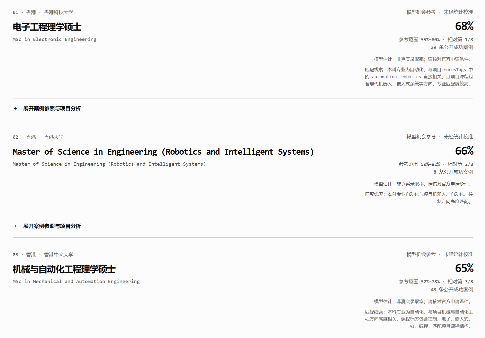
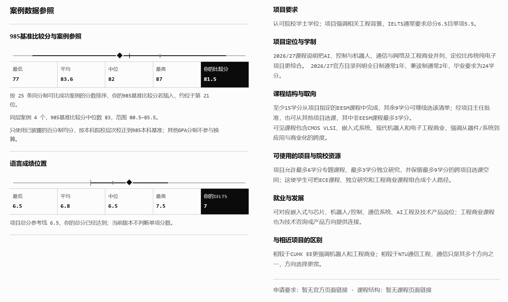
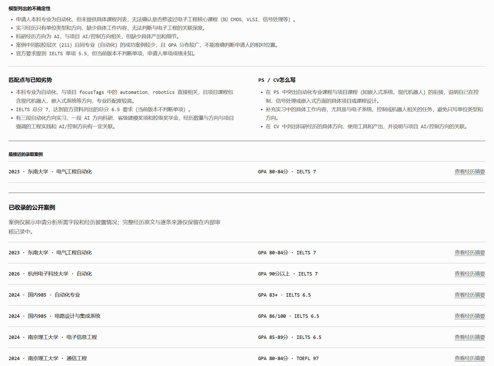
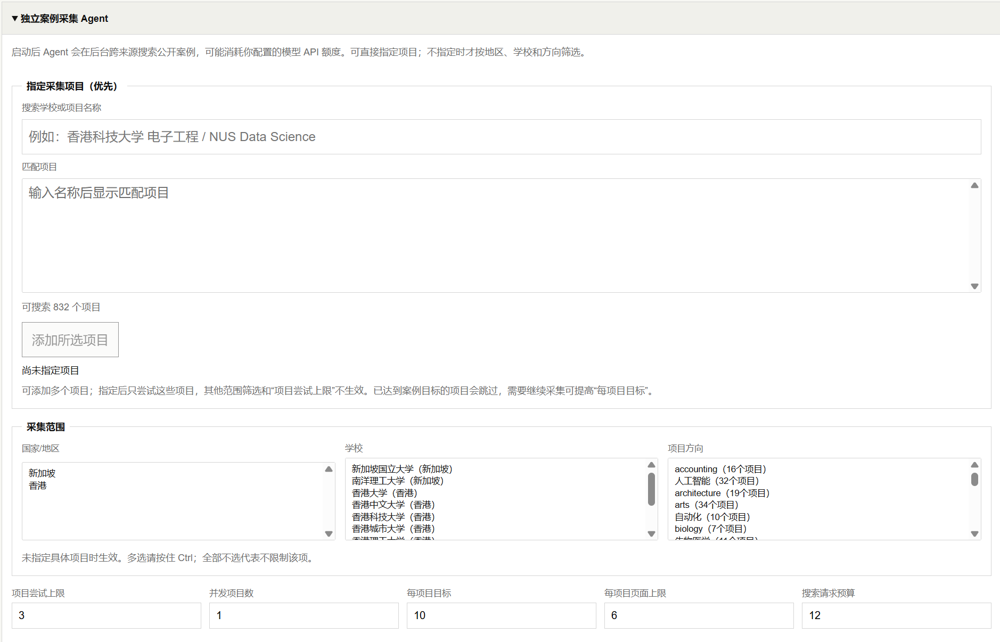
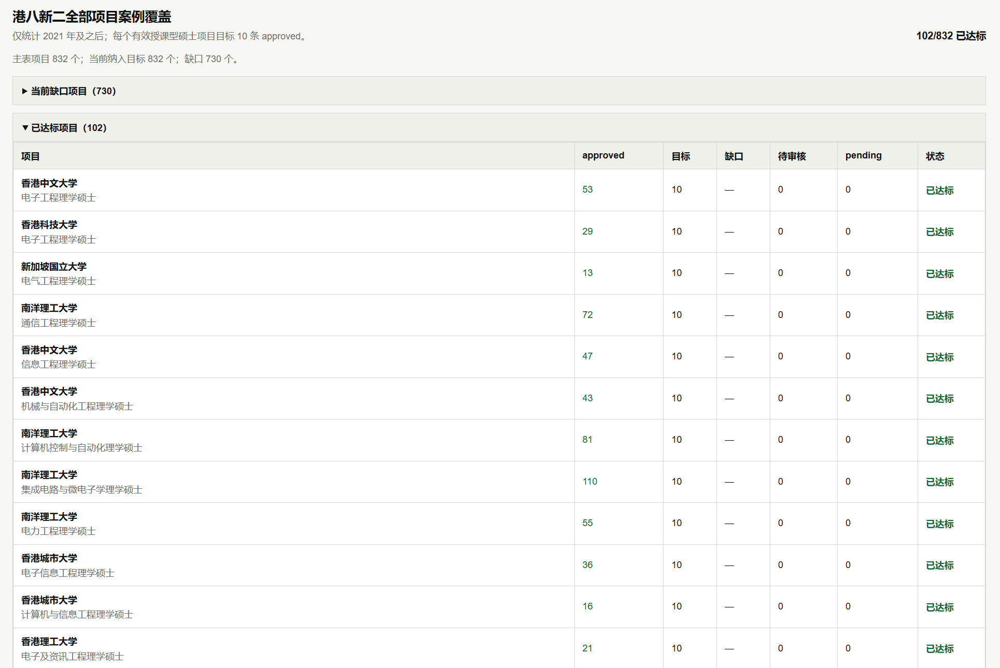

# 录取参照 · Admission Reference

面向香港、新加坡授课型硕士申请者的 Windows 桌面产品：**用少量背景信息筛选项目，把学校项目资料、已审核的公开成功案例和个人条件放在一起比较，帮助申请者决定哪些项目值得进一步了解。**

[下载 Windows 便携版 v0.1.18](https://github.com/J1n95/admission-agent/releases/tag/v0.1.18) · [查看产品需求文档（PRD）](docs/PRD-录取参照-产品需求.md) · [查看演示说明](docs/demo-申请分析Agent-2026-10-18.md)

> 这是申请决策辅助原型，不是录取率计算器。页面百分比是**未经真实录取与拒录结果校准的模型参考值**，不是学校录取率、保底承诺或申请资格认定。

## 产品总览

录取参照是一款面向香港、新加坡授课型硕士申请者的 Windows 桌面工具。申请者填写本科背景、成绩和申请意向后，产品从已收录的项目中筛选候选项，再对照本地项目资料与已审核的公开成功案例，给出单项目分析和多项目比较。申请者可以查看匹配依据、资料缺口与申请材料建议，自己决定下一步研究哪些项目；模型给出的百分比仅作未经校准的参考。

产品还提供独立的公开案例采集与人工审核流程，用于补充后续分析的案例证据。使用者自备模型 API；申请分析不会在每次运行时自动联网核验学校官网。

## 为什么做这个产品

准备申请时，学生往往知道自己的学校、专业和成绩，却不知道该从哪些项目查起。项目要求分散在学校页面，公开成功案例又分散在不同平台；找到案例后，还要判断它与自己的背景是否真的可比。逐个搜索、对照和准备材料会占用时间，每增加一个申请项目也可能增加费用。

录取参照把这些信息放进同一次分析：**先找到可进一步考虑的项目，再看匹配依据和资料缺口，最后由申请者自己决定申请顺序。** 减少查找成本是产品目标，目前尚无真实用户实验可以量化节省的时间或费用。

## 用户会看到什么

| 使用环节 | 产品给出的内容 | 帮助用户回答的问题 |
| --- | --- | --- |
| 描述背景与意向 | 填写本科院校、专业、成绩、语言总分及可选经历；选择地区、学校和方向 | 我想比较哪些项目？ |
| 筛选候选项目 | 根据背景和意向保留相关项目，并说明匹配线索 | 哪些项目值得打开细看？ |
| 查看单项目分析 | 对照项目资料、已审核公开案例、个人成绩和经历；展示匹配点、待核实事项及 CV/PS 内容建议 | 我为什么适合或不适合？判断依据是什么？ |
| 比较多个项目 | 按通过校验的模型参考值从高到低展示，附区间、案例量和不确定性；无数值时说明原因 | 我该先研究哪些项目？ |

案例少并不等于项目不值得申请。系统会提示证据不足，不把少数成功案例的最低成绩当成录取门槛；模型调用或证据校验失败时，也不会用编造的数字补位。它提供申请参考，不自动替用户划分“冲刺／保底”。

## 具体功能与界面

以下截图用于说明当前产品流程，局部文字可能与 v0.1.18 不同，以实际程序为准。截图中的百分比是模型参考值，不是真实录取率。

### 1. 填写背景与申请意向

输入本科院校、专业、成绩和语言总分；实习、科研与奖项没有也可留空。再选择申请地区、学校和目标方向，并确认实际修读的课程。这样就能从自己的背景出发筛选项目，不需要先逐个查找项目页面。





### 2. 筛选并比较候选项目

在同一页查看候选项目、匹配线索、公开案例数量和模型参考值；有数值的结果按参考值从高到低展示。公开成功案例少于 5 条时只显示宽区间，中心值仅用于内部排序；无法给出数值时说明原因。



### 3. 打开项目，看依据与建议





图中的“985 基准比较分”是程序内部的案例比较口径，**不是学校官方成绩换算或录取门槛**；部分项目资料链接仍有缺口。语言判断只涉及已收录的总分，不评估单项成绩。

## 产品如何工作

```text
申请分析：背景与意向 → 候选项目筛选 → 检索本地项目资料和已审核案例
          → 逐项目分析 → 引用与规则校验 → 跨项目比较及结果展示

案例采集：指定项目 → 搜索公开案例并抽取信息 → 去重与项目映射
          → 人工审核 → 通过后供下一次申请分析使用
```

这两条流程在同一个 EXE 中，但职责不同：案例采集负责补充并审核证据，申请分析才使用审核通过的案例。模型处理项目名称、经历和案例等开放文本；本地规则处理原始成绩制式、案例可比性、输出格式与证据边界。分析时使用已有的本地资料快照，**不会在每次分析时自动上网核验学校官网**；采集案例则是单独的联网功能。详细流程见[产品需求文档（PRD）](docs/PRD-录取参照-产品需求.md)与[方法说明](METHODOLOGY.md)。



采集到的新案例需要审核通过，才能成为下一次分析的证据；采集公开案例**不会自动补齐项目官网资料**。

<details>
<summary>查看案例覆盖与审核状态</summary>



图中的“达标”仅指达到每项目 10 条 approved 案例的采集目标，不代表全部项目资料完整或分析结论可靠。

</details>

v0.1.18 随包快照包含 832 个项目目录项和 3,435 条已审核公开成功案例；这是**包内数据量**，不代表每个项目都有足够案例、资料完整或官网信息实时更新。

## 下载与体验

公开版本是 [v0.1.18 Windows ZIP](https://github.com/J1n95/admission-agent/releases/tag/v0.1.18)。解压后运行 `录取参照.exe`，无需安装 Node.js；首次使用需填写自己的 HTTPS Chat Completions 接口地址、模型名称和 API Key，可先测试连接。软件未签名，Windows 首次启动可能显示来源提醒。

API Key 加密保存在本机，申请记录与反馈也保存在本机并可删除；但分析请求中的申请资料和检索证据会发送给用户选择的模型服务商，费用及服务商的数据处理规则由用户自行确认。已发送的数据无法通过删除本机记录撤回。案例采集会访问外部网页，也可能产生模型调用费用；新案例只有审核通过后才参与分析。

## 已验证的范围与尚未解决的问题

- 本机实验版使用六份合成申请背景完成 24 次 DeepSeek Flash 请求，覆盖项目筛选、单项目分析和跨项目比较；修复一处本地校验器误报后，保存的原始响应离线复核通过 24/24。这证明固定场景下的结构与规则表现，**不是模型事实准确率提升或录取概率准确率**。[查看复测记录](docs/cross-discipline-eval-2026-10-18.md)
- v0.1.17 以 4 份合成资料执行 15 次 DeepSeek Flash 真实桌面全流程请求：强经历双非在两个共同金融项目的参考顺序高于弱经历 985；工业设计和新闻学场景分别排除了时尚/建筑设计与创意媒体等相邻方向。结果只证明这些固定场景通过，不代表所有专业均已验证或概率准确。[查看迭代记录](docs/iteration-2026-10-13.md#33-求职演示版全流程验收与稀疏案例展示2026-10-19)
- v0.1.18 修复桌面初筛把 10–12 秒正常模型延迟误判为超时的问题，并让多方向申请先覆盖各方向核心候选。杭州师范大学金融学的固定场景完成两轮真实全流程复测；第二轮同时保留金融、会计和商业数据分析项目。[查看修复记录](docs/iteration-2026-10-13.md#34-项目初筛误超时与多方向候选偏置2026-10-19)
- 不同项目的案例量和资料完整度不同；本机同条件测试发现跨院校模型百分比顺序仍不稳定，不能据此宣称跨院校机会排序可靠。[查看迭代记录](docs/iteration-2026-10-13.md)
- 没有真实录取／拒录结果用于校准百分比，也未逐条人工核验全部项目事实和模型引用。当前只比较已收录的 IELTS／TOEFL **总分**，不判断单项分数；完整、当年的申请条件仍应以学校官网为准。

## 进一步了解

[产品需求文档（PRD）与版本更迭](docs/PRD-录取参照-产品需求.md) · [系统流程](SYSTEM-MAP.md) · [评测方法与原始记录说明](eval/README.md) · [迭代记录](docs/iteration-2026-10-13.md)

仓库公开源码和方法说明，但不包含构建同一 ZIP 所需的完整本地案例库、院校参考库与脱敏 Agent 快照，**仅下载源码无法直接复现公开安装包**。原始身份信息、申请记录和采集缓存不上传到仓库。当前未设置开源许可证；请勿把公开代码或随包资料直接用于商业服务。
