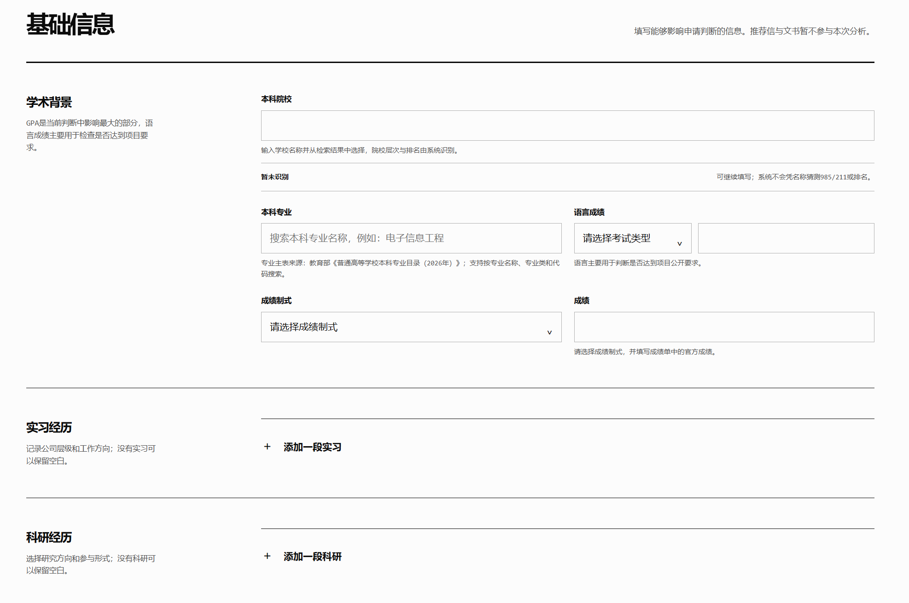
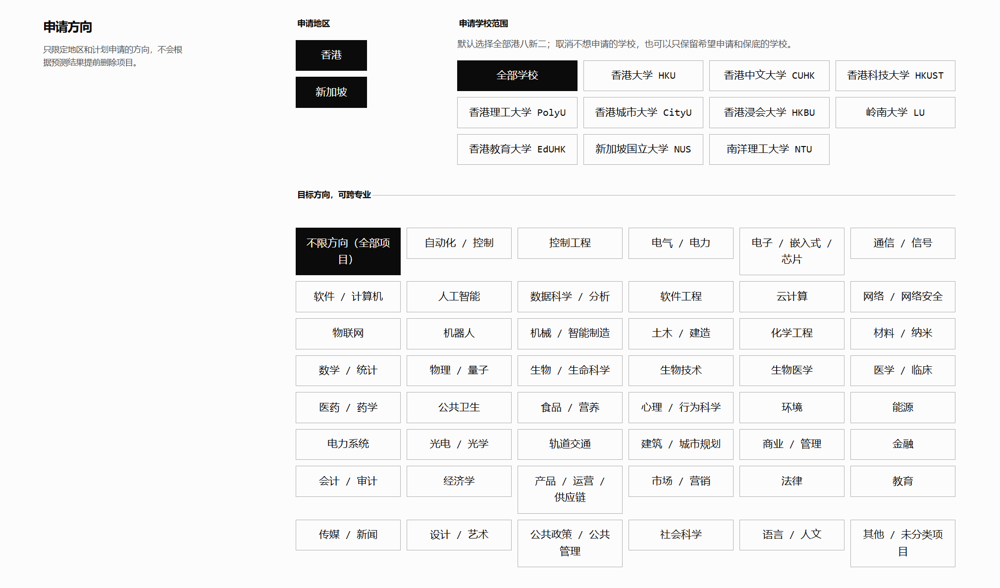
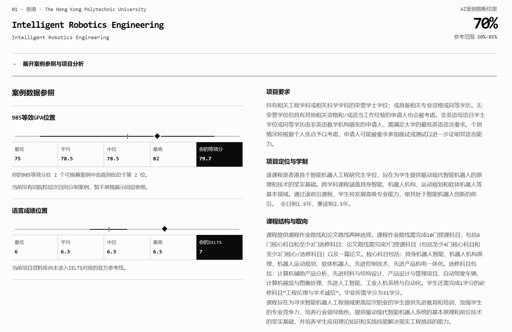
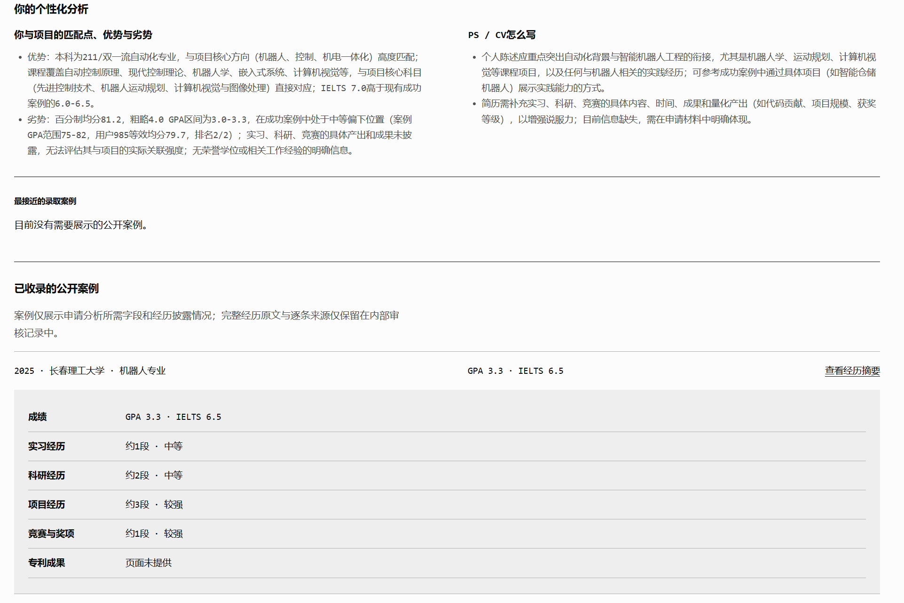

# 录取参照 · Admission Reference

录取参照是面向香港及新加坡授课型硕士申请者的 Windows 桌面 Agent。申请人填写院校、专业、成绩和少量经历后，系统筛选候选项目，结合本地项目资料和已审核的公开成功案例，给出匹配理由、证据对照、改进建议和跨项目比较。公开案例采集与人工审核是另一条独立流程。

本项目是申请决策辅助原型。百分比为未经真实录取结果校准的模型参考值，不是学校录取率或保底承诺；项目资料是本地快照，完整要求请以学校官网为准。桌面版由使用者自行配置兼容 Chat Completions 的模型 API。

项目材料：[产品需求文档](docs/PRD-录取参照-产品需求.md) · [现状与评测](docs/PRD-录取参照-现状与评测.md) · [岗位演示说明](docs/demo-申请分析Agent-2026-10-18.md) · [迭代记录](docs/iteration-2026-10-13.md)。

## 产品预览


### 申请人信息填写





### 分析结果





## 能做什么

- 录入本科院校、专业、成绩制度、GPA/均分和语言成绩。
- 添加课程、实习、科研、项目、竞赛和奖项经历。
- 按申请地区、目标学校范围和专业方向筛选项目。
- 根据本科专业、课程和经历进行第一层项目匹配。
- 结合项目官方资料和公开录取案例进行第二层分析。
- 输出案例分布、项目匹配点、优势短板和 CV/PS 建议；模型参考值默认显示，并附区间、相对排序、案例数量和未校准提示，不能视为真实录取率或保底承诺。
- 反馈可选，不影响下载摘要；申请记录与反馈保存在本机，可从程序菜单删除。
- 支持结构化案例检索，并预留可选的 Embedding 向量检索能力。

## 分析流程

```text
申请人填写背景
       ↓
地区、学校、专业和课程筛选
       ↓
第一层 Agent 选择匹配项目
       ↓
检索官方项目资料与已审核案例
       ↓
第二层 Agent 综合分析
       ↓
项目匹配、证据边界和申请建议
```

## 使用的方法

- 结构化筛选：按地区、学校、专业、课程、成绩和经历进行召回。
- 两层 Agent：第一层负责选项目，第二层负责案例与项目综合分析。
- RAG 思路：优先使用已审核案例和项目官方资料作为分析依据。
- LLM 信息抽取：识别案例中的项目名称、GPA、语言成绩、院校层次和经历。
- OCR 辅助识别：处理图片型或复杂排版的公开案例页面。
- 规则校验：负责项目匹配、字段校验、去重、审核状态和安全边界。
- SQLite 数据管理：保存项目主表、院校主表、案例、分析记录和反馈结构。

## Windows 桌面版

下载 [Windows 便携版 ZIP（v0.1.14）](https://github.com/J1n95/admission-agent/releases/tag/v0.1.14)，解压后运行 `录取参照.exe`，无需安装 Node.js。首次打开填写你自己的 HTTPS Chat Completions 接口地址、模型名称和 API Key；可先点“测试连接”。软件使用包内的本地资料快照，分析请求中的申请资料及相关证据会发送给所选模型服务商，费用由该服务商向你的账号收取。请先确认其隐私条款。API Key 加密保存在 Windows 用户配置目录中；申请记录和反馈也只保存在本机。程序菜单提供“删除本机申请记录”，但不能撤回已发送给模型服务商的数据。ZIP 未签名，Windows 可能显示来源提醒。

页面右上角“案例采集与审核”（或程序菜单中的同名入口）可在同一个 EXE 中启动公开案例采集、查看运行状态和审核候选案例。在“指定采集项目”里搜索学校或项目名称、选中匹配项并点“添加所选项目”，可重复添加多个项目；启动后只尝试这些项目。未指定项目时才使用地区、学校和方向筛选，默认最多尝试 3 个项目。已经达到“每项目目标”的项目会跳过，如需继续采集可提高目标数。采集会访问外部网页并调用已配置的模型 API，可能产生费用；新案例先保存在本机，只有审核通过的案例会在下一次申请分析时进入证据库。关闭程序会停止正在运行的采集任务。采集来源受白名单和 robots.txt 限制；本功能不保证一定找到新案例。

源码不包含完整案例库、院校参考库及脱敏 Agent 快照；仅下载仓库源码无法直接运行 `desktop:build`。开发者需先自行准备这些本地资料，再使用 Node.js 22 或更高版本执行 `npm install`。构建及检查：

```powershell
npm run desktop:build
npm run desktop:test
npm test
```

`desktop:test` 中的 50 条语言声明场景是合成规则回归测试，**不是**真实 Agent 准确率评测。评测边界见 `eval/README.md`。

本轮产品判断、修改过程、验证证据和简历表述边界见 [2026-10-13 迭代记录](docs/iteration-2026-10-13.md)。

## 旧版开发服务器（仅维护数据与调试，不作为公开产品）

要求 Node.js 版本支持 `node:sqlite`，推荐 Node.js 22 或更高版本。

```powershell
git clone <your-repository-url>
Set-Location admission-agent
Copy-Item .env.example .env
node server.mjs
```

打开：

```text
http://127.0.0.1:4173
```

健康检查：

```text
http://127.0.0.1:4173/api/health
```

## 旧版服务端 API 配置

API 只允许通过服务端 `.env` 配置，不能写入前端代码、README 或 GitHub 仓库。

复制 `.env.example` 为 `.env` 后，按需配置兼容 Chat Completions 的模型接口：

```text
COLLECTOR_AI_API_URL=
COLLECTOR_AI_API_KEY=
COLLECTOR_AI_MODEL=
```

如果不配置 API，旧版开发服务仍可展示项目资料，但不会生成新的个性化 AI 分析。桌面版通过“模型 API 设置”界面配置，无须编辑 `.env`。

管理员入口需要配置：

```text
ADMIN_PASSWORD=
```

## 数据说明

源数据库中的原始身份信息、用户申请记录、问卷反馈、采集缓存和运行备份不会上传到 GitHub。桌面 ZIP 内含经筛选和脱敏的公开案例快照及院校资料，接收 ZIP 的人可以读取这些资料；分发前仍须复核授权与隐私边界。

`collector/data/cases.sqlite` 是本地运行数据库，首次启动时在本机生成或使用本地已有数据。项目中的主表代码和公开资料结构可以公开，但真实用户数据和完整案例库应当放在受保护的存储中。

## 旧版 Docker 开发环境

```powershell
docker compose up -d --build
```

生产环境必须：

- 使用强管理员密码。
- 通过环境变量注入 API 密钥。
- 使用持久化磁盘保存 SQLite 数据。
- 在反向代理或 CDN 层配置 HTTPS 和访问限流。
- 不公开管理员审核页面和真实案例数据库。

## 测试

```powershell
npm.cmd test
```

## 项目状态

这是一个持续迭代中的个人项目/研究原型，当前重点是验证项目筛选、案例检索、AI 分析解释和用户反馈闭环。公开录取案例具有样本偏差，项目结果不能替代学校官网和正式申请材料。

## License

暂未设置开源许可证。未经作者授权，不建议将本项目用于商业服务。
