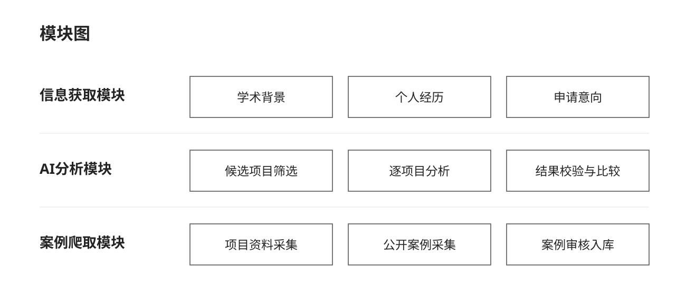
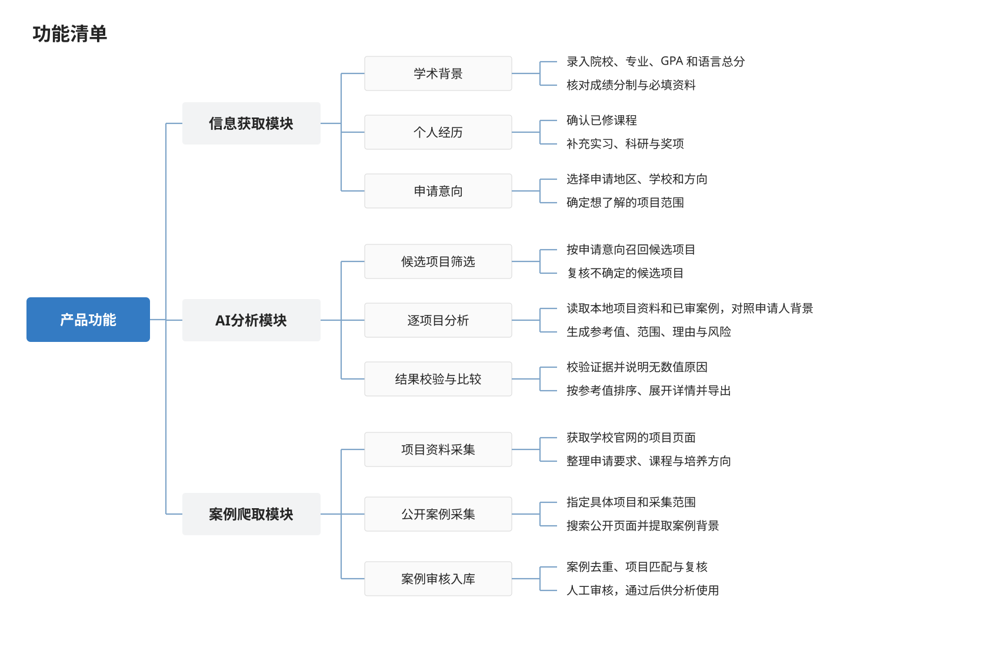
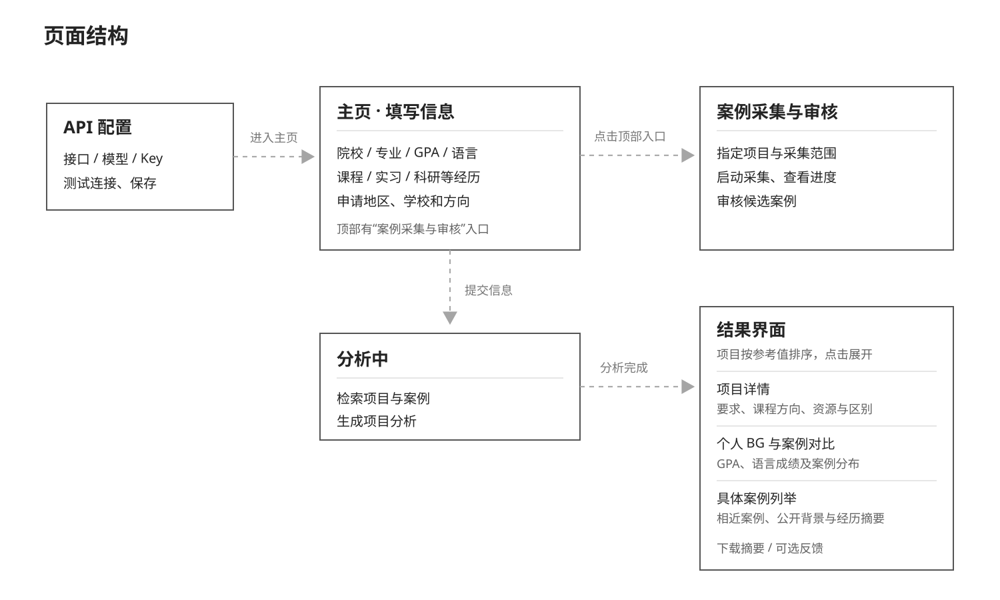

# 录取参照｜产品需求文档（桌面版现状）

## 1. 版本说明

| 项目 | 内容 |
| --- | --- |
| 文档日期 | 2026-10-19 |
| 对应产品 | Windows 桌面版 0.1.20 便携版；用户自配模型 API |
| 文档用途 | 说明产品要解决的问题、现有功能和验收方式 |
| 状态口径 | **已实现**＝代码/界面存在；**已测试**＝有本地测试；**待实测**＝真实 API、联网或用户效果未验收；**候选**＝尚未决策 |

版本更迭（按有明确产品变化记录的版本）：

| 版本 | 主要变化 |
| --- | --- |
| 0.1.2 | 展示模型给出的百分比、区间和案例数；项目按参考值排序，补齐已有官方资料的展示。 |
| 0.1.3 | 处理模型接口并发失败，说明项目没有数值的原因；取消自动申请分层。 |
| 0.1.4 | 语言要求只判断总分，不因未采集的小分阻断结果。 |
| 0.1.5 | 将案例采集和人工审核接入桌面程序；审核通过的案例可用于后续分析。 |
| 0.1.6 | 在主页增加“案例采集与审核”入口。 |
| 0.1.7 | 支持指定具体项目采集案例，修复桌面版项目目录漏打包。 |
| 0.1.9 | 在设置页加入千问与 DeepSeek 双模型对比入口。 |
| 0.1.10 | 在主页增加“模型 API 设置”入口，方便修改配置和进入模型对比。 |
| 0.1.11 | 调整模型输出长度与证据格式校验；修正案例名次和语言总分证据边界；依据模型对照及匿名盲评，迭代少案例 GPA、未填写信息与已知劣势的判断规则；完成六类专业合成复测并构建本机演示包。[迭代记录](iteration-2026-10-13.md) |
| 0.1.12 | 修复四分制/五分制 GPA 被线性换算为百分制并影响案例名次的问题；报告隐藏内部证据 ID，保留可读证据说明；完成五分制合成场景复测。[修复记录](iteration-2026-10-18-gpa-and-evidence.md) |
| 0.1.13 | 改进成绩填写指引和证据展示，用户报告中不再显示内部证据编号；构建本机演示 ZIP。[迭代记录](iteration-2026-10-13.md) |
| 0.1.14 | 在四分制、五分制选项直接标注“不推荐，分析效果不佳”；将此前仅在源码中的提示打入新版 Windows ZIP，并提供公开下载入口。[发布核验](iteration-2026-10-13.md#29-求职演示包公开发布与成绩提示验收2026-10-18) |
| 0.1.15 | 补充经核验的非 985/211 双一流院校身份；未知院校不再按名称猜测层次；百分制无法比较时仍展示用户填写的原始均分；清理报告中的内部案例指纹。[修复记录](iteration-2026-10-13.md#30-非-985211-双一流院校识别与均分证据显示2026-10-18) |
| 0.1.16 | 项目初筛不再强制补足 8 项；院校输入模块恢复加载并保持黑色选中样式；百分制且院校身份已核验时，横向校准同时输出四档院校对照并检查顺序，失败时不展示未经检查的参考值。[修复记录](iteration-2026-10-13.md#32-院校档次对照与院校输入-ui-回归修复2026-10-18) |
| 0.1.17 | 扩大内部引用编号清理范围；项目筛选要求细分方向的正面证据；完成强经历双非与弱经历 985、工业设计与新闻学的真实桌面全流程小样本验收；公开成功案例少于 5 条时只显示区间，不显示单点中心值。[验收记录](iteration-2026-10-13.md#33-求职演示版全流程验收与稀疏案例展示2026-10-19) |
| 0.1.18 | 项目初筛默认超时由 10 秒调整为 30 秒，并统一中文超时提示；多方向输入先让每个方向的核心项目进入候选池，减少目录顺序与宽泛标签造成的单一方向偏置。[复测记录](iteration-2026-10-13.md#34-项目初筛误超时与多方向候选偏置2026-10-19) |
| 0.1.19 | 本机版本仅补杭州师范大学的院校身份；后续 0.1.20 改为批量覆盖。[问题记录](iteration-2026-10-13.md#35-杭州师范大学均分图缺失2026-10-19) |
| 0.1.20 | 依据本地教育部院校名单批量识别内地本科层次；保留原始均分并注明内部比较分的假设范围与未校准边界，不对合作办学强行换算。[修改记录](iteration-2026-10-13.md#36-内地本科院校层次批量识别与均分口径边界2026-10-19) |

0.1.11–0.1.13 均为本机演示构建；0.1.14 首次将新版打包用于公开下载，0.1.15–0.1.18 继续修正院校识别、项目筛选、同条件档次对照、稀疏案例展示和请求稳定性；0.1.19 为本机单校修复，0.1.20 改为批量识别。构建与少量合成场景验收不等于全专业端到端验收；四档对照只能约束同一申请资料的内部一致性，模型百分比仍未经真实录取结果校准。

## 2. 背景与目标

**背景：** 想申请香港、新加坡硕士的学生，常常不知道凭自己的学校、专业、成绩和经历，适合申请哪些项目。网上的录取案例散落在不同中介和平台，信息不全、写法不一；要找到与自己背景相近的案例并整理出来很费时间。找到项目后，还要逐个查课程、研究或实践方向、申请要求，以及相似项目之间的区别。每多申请一个项目都会增加申请费和准备材料的成本。

**目标：** 把分散的公开案例和学校官方项目资料整理在一起。用户输入自己的背景后，就能看到值得考虑的项目、相近案例、课程与方向、项目差异和申请要求。最后给出有依据的百分比形式**录取概率参考**，按高低排列，让申请者自己决定申请哪些项目、先准备什么，减少重复查找和不必要的申请开销。

目前的百分比是未经统计校准的模型参考值，不是真实录取率。每年的申请时间由用户自行查询学校官网。

## 3. 故事介绍

### 3.1 用户场景

一名准备申请港新硕士的学生，知道自己的成绩和经历，却不确定哪些项目值得申请。他希望少花时间翻找分散的案例，也避免为不合适的项目支付申请费。

- 用户填写本科院校、专业、成绩、语言成绩和相关经历，并配置自己的模型 API。
- 用户选择感兴趣的地区、学校或专业方向，查看可以进一步了解的项目。
- 用户打开具体项目，查看已整理的项目要求、课程方向和公开录取案例，再对照自己的背景。
- 用户查看各项目的录取机会参考百分比、案例数量和分析理由。百分比标明是未经统计校准的模型估计，不当作真实录取率；依据不足时也说明原因。
- 用户按参考值从高到低浏览项目，自行决定优先研究和申请哪些项目。遇到特别想申请、但案例不足的项目，可以指定该项目补充采集公开案例。

### 3.2 价值分析

申请者缺的不是更多零散信息，而是把自己的条件、项目要求和录取案例放在一起比较的依据。产品将这些资料整理到同一处，帮助用户更快判断哪些项目值得深入了解、哪些项目可能不适合自己。

| 用户要做的事 | 现在的困难 | 产品提供的价值 |
| --- | --- | --- |
| 找合适的项目 | 不知道从哪些学校和专业开始查 | 根据个人背景和意向，找到可进一步考虑的项目 |
| 判断自己是否匹配 | 案例分散，背景不同，难以直接比较 | 同时展示相近案例、项目要求及个人条件的匹配点和风险 |
| 决定申请哪些项目 | 每申请一个项目都要投入时间和费用 | 提供按高低排列的机会参考和分析理由，由用户自己决定取舍 |

这里的百分比是**未经统计校准的模型参考值，不是真实录取率**。目前也没有实测数据证明产品能节省多少时间或申请费用，因此这两项先写作预期价值，不写具体数字。

### 3.3 核心体验路径

```text
首次配置自己的模型 API
         ↓
填写背景和申请意向 → 筛选候选项目 → 对照项目资料与公开案例
         ↓
查看参考值、理由和不确定性 → 按参考值浏览 → 自行决定是否申请

案例不足时：指定项目采集 → 人工审核案例 → 下次分析才使用审核通过的案例
```

如果模型调用或证据校验失败，项目仍可展示，但应说明原因，不用编造的百分比填空。申请开放和截止时间由用户自行查学校官网。

### 3.4 路径规划

**当前版本**

- 用户在 Windows 桌面程序中配置自己的模型 API，填写申请背景和意向。
- 产品结合本地项目资料与已审核公开案例，筛选项目，展示逐项目分析、参考值和理由，供用户按高低比较。
- 用户可指定某个项目采集公开案例；案例审核通过后，才用于后续分析。
- 用户可导出分析摘要，并自行决定是否申请。

**未来规划：定制 PS 和 CV（尚未实现）**

- 用户选定目标项目后，深入拆解其培养目标、课程设置、研究方向和项目特色，形成适合该项目的申请者画像。
- 对照用户填写的课程、项目、实习和个人动机，找出与项目契合的经历、能力和个人特色，确定 PS 和 CV 应重点呈现什么。
- 围绕这些真实素材，生成针对该项目、有个人特色的 PS（个人陈述）和 CV（简历）草稿，供用户修改定稿；不编造经历或成绩。

## 4. 概要设计

### 4.1 模块设计

申请人信息由用户填写；项目资料和公开案例由采集流程获取，分析时读取本地已有资料。



### 4.2 功能清单



### 4.3 页面结构



## 5. 详细设计

下表根据当前桌面版已有页面和交互整理。

### 5.1 当前页面与交互

| 页面 | 逻辑 |
| --- | --- |
| API 配置 | - 填写 HTTPS Chat Completions 接口地址、模型名和 API Key；缺项、协议或接口路径不正确时提示错误。 |
| API 配置 | - 可测试连接；显示连接成功、接口错误或超时。测试后仍可直接保存。 |
| API 配置 | - 首次保存后加密保存 API Key 并启动软件；软件运行后修改配置会重启，Key 留空时沿用已保存的 Key。 |
| API 配置 | - 设置页说明申请资料和检索证据会发送给所选模型服务商，模型费用由用户承担；API Key 不发送给项目服务器。 |
| 桌面菜单 | - 打开模型 API 设置、进入案例采集与审核、删除本机申请记录或退出软件。 |
| 填写主页 · 学术背景 | - 搜索本科院校并选择匹配结果；匹配到时显示院校层次与识别信息，未匹配时仍可填写。 |
| 填写主页 · 学术背景 | - 按专业名称或代码搜索本科专业；选择专业后载入对应的预选课程。 |
| 填写主页 · 学术背景 | - 选择百分制、四分制或五分制并填写成绩；切换制式时更新输入范围，保留原始制式和分数。 |
| 填写主页 · 学术背景 | - 选择 IELTS 或 TOEFL iBT，填写语言总分；按考试类型更新分数范围，不填写单项小分。 |
| 填写主页 · 经历与课程 | - 添加、编辑或删除多段实习、科研、竞赛与奖项；没有相关经历时可以留空。 |
| 填写主页 · 经历与课程 | - 填写实习公司层级与方向、科研方向与参与形式、奖项层级与类别。 |
| 填写主页 · 经历与课程 | - 按实际修读情况勾选课程，可补充其他课程名称。 |
| 填写主页 · 申请范围 | - 选择香港、新加坡或两地；按地区筛选学校，可选全部或指定学校。 |
| 填写主页 · 申请范围 | - 选择不限方向或多个目标方向；跨专业项目也可纳入分析。 |
| 填写主页 · 申请范围 | - 提交时检查必填资料和申请范围；未通过时在表单处提示。勾选数据使用说明后开始分析。 |
| 填写主页 · 申请范围 | - 从页面顶部进入案例采集与审核。 |
| 分析中 | - 展示核对背景、检索项目与案例、整理证据、生成项目判断、整理结果五个阶段和进度提示。 |
| 分析中 | - 读取本机项目资料与审核通过的案例；申请资料和检索证据发送给用户配置的模型服务商。 |
| 分析中 | - 模型调用失败时显示错误提示；结果仍可查看本机已有的项目资料和案例，不展示未通过校验的模型数值。 |
| 结果界面 · 项目列表 | - 有模型参考值的项目按数值从高到低排列；没有数值的项目列在后面并显示原因。 |
| 结果界面 · 项目列表 | - 公开成功案例不少于 5 条时，显示学校、项目名称、参考中心值及区间、公开案例数和个性化匹配线索。 |
| 结果界面 · 项目列表 | - 公开成功案例少于 5 条时，只显示宽区间、案例数和低证据提示；中心值仅用于内部排序，不在页面和导出报告中显示。 |
| 结果界面 · 项目列表 | - 页面说明模型百分比未经录取与拒录数据校准，不是真实录取率。 |
| 结果界面 · 项目详情 | - 展开查看项目要求、定位与学制、课程方向、院校资源、就业信息及相近项目区别；缺少资料时显示暂无资料或待核对提示。 |
| 结果界面 · 项目详情 | - 查看个人 GPA、语言总分与公开案例分布的对照，最接近案例和具体案例摘要。 |
| 结果界面 · 项目详情 | - 查看模型判断理由、引用资料、不确定性和官方页面链接。 |
| 结果界面 · 项目详情 | - 查看模型生成的个性化匹配建议及 PS/CV 写作建议；不生成完整 PS 或 CV 文档。 |
| 结果界面 · 导出反馈 | - 返回修改资料并重新分析；可下载 TXT、Markdown 或 CSV 摘要。 |
| 结果界面 · 导出反馈 | - 可选填写三道反馈题和补充意见；跳过反馈仍可下载摘要。 |
| 案例采集 · 选择范围 | - 搜索并添加一个或多个具体项目；指定后其他范围筛选和项目尝试上限不生效，已达案例目标的项目会跳过。 |
| 案例采集 · 选择范围 | - 未指定具体项目时，可按地区、学校和项目方向筛选；未选条件表示不限制。 |
| 案例采集 · 运行控制 | - 设置项目尝试上限、并发数、每项目案例目标、页面上限和搜索请求预算；可选择导入 Mastermate 索引。 |
| 案例采集 · 运行控制 | - 启动前确认联网采集和模型 API 调用；运行中显示状态与日志，可停止采集并刷新状态。 |
| 案例采集 · 覆盖情况 | - 按项目查看已通过、待审核、待分流案例数、目标数量和缺口；另列不纳入当前目标的项目及原因。 |
| 案例审核 | - 按待处理状态查看案例，打开来源并核对项目、年份、申请人院校、专业、GPA 和语言成绩。 |
| 案例审核 | - 编辑案例字段后保存；可将案例设为通过、排除或保留。只有通过的案例进入分析。 |
| 案例审核 | - 可预览并应用高置信度自动分流；可对最多 5 条案例进行模型试审，预览后确认应用。 |

本项目先完成 Agent 和页面，之后补写 PRD。以下为 2026-10-18 本机演示版截图，用于说明页面结构；局部文字可能与公开下载的 0.1.20 版不同。


### 5.2 分析怎么做、模型怎么选、用了哪些资料

#### 5.2.1 分析怎么做

桌面程序负责填写资料和展示结果；本机数据库保存项目资料与案例；用户配置的模型 API 负责分析。用户提交后，系统从本机资料中挑选项目，把相关的官方项目信息和已审核案例交给模型逐个分析，再检查引用、整理排序。逐项目分析最多同时处理 2 个项目。**分析时不会上网搜索新项目或案例**；联网采集案例是另一个独立功能。[实现](../desktop/legacy-analysis.mjs)。

#### 5.2.2 模型怎么选

用户自己提供模型 API Key，目前没有指定唯一模型。已完成千问 Flash、千问 Plus 与 DeepSeek Flash 的固定场景对照，并对 6 个单项目分析及跨项目排序场景做了匿名人工评分；评分显示 DeepSeek Flash 与千问 Plus 总分并列。该结果是小样本、单人主观可用性评价，事实与引用尚未逐条核验，费用为 Token 估算且未核对服务商账单，因此还不能据此确定普遍最优模型或真实录取预测能力。产品默认模型未因此更改。[对比方案与记录](../eval/README.md)；[完整迭代记录](iteration-2026-10-13.md)。

#### 5.2.3 目前有哪些资料

本机已整理项目资料和公开录取案例，供分析时查阅，不是用来训练新模型。当前打包的数据文件包含 832 个项目、7,672 条项目资料记录和 3,435 条已审核的公开成功案例；新案例审核通过后才能使用。这些数据没有完整的申请人数和拒录结果，所以显示的百分比只能作为**模型给出的申请机会参考**，不能当作真实录取率。[数据准备](../scripts/build-desktop-seed.mjs)、[方法说明](../METHODOLOGY.md)。

## 6. 交付设计：验收、评测、成本与交接

验收覆盖打包与入口、模型调用、证据正确性、结果展示和费用记录。

### 6.1 埋点数据

这里把每个已保存的资料字段都列为一个数据点。申请资料是在用户提交分析后作为一条本机记录保存，不是每次输入框变化就单独上传。API Key 不进入分析记录。

#### 分析 Agent

| 模块 | 埋点 |
| --- | --- |
| 申请人背景 | - 本科院校名称。 |
| 申请人背景 | - 院校层次和分类；系统识别不到时保留未知，不凭名称猜测。 |
| 申请人背景 | - 本科专业名称。 |
| 申请人背景 | - 本科专业代码。 |
| 申请人背景 | - 本科专业所属方向。 |
| 申请人背景 | - 成绩制式：百分制、四分制或五分制。 |
| 申请人背景 | - 成绩单上的原始成绩数值。 |
| 申请人背景 | - 语言考试类型：IELTS 或 TOEFL iBT。 |
| 申请人背景 | - IELTS 总分或 TOEFL iBT 总分；当前不收集小分。 |
| 课程与经历 | - 勾选的已修课程名称。 |
| 课程与经历 | - 课程方向标签；由所选课程生成。 |
| 课程与经历 | - 手动补充的其他课程。 |
| 课程与经历 | - 每段实习的公司层级。 |
| 课程与经历 | - 每段实习的工作方向。 |
| 课程与经历 | - 每段科研的研究方向。 |
| 课程与经历 | - 每段科研的参与形式。 |
| 课程与经历 | - 每个竞赛或奖项的层级。 |
| 课程与经历 | - 每个竞赛或奖项的类别。 |
| 申请目标 | - 选择的申请地区。 |
| 申请目标 | - 指定的目标学校；选择全部学校时保存为不限制。 |
| 申请目标 | - 指定的目标方向；选择全部方向时保存为不限制。 |
| 申请任务 | - 分析任务 ID 和创建时间。 |
| 申请任务 | - 用户确认的数据使用说明版本。 |
| 申请任务 | - 任务状态：处理中、完成或失败。 |
| 申请任务 | - 分析完成时间和失败信息。 |
| 分析结果 | - 入选项目及各项目的模型参考值、参考范围或“暂无数值”。 |
| 分析结果 | - 各项目的判断理由、引用资料和公开案例。 |
| 分析结果 | - 请求评估、完成评估和失败评估的项目数。 |
| 分析结果 | - 各项目未完成评估的原因。 |
| 问卷反馈 | - 对应的分析任务 ID 和提交时间。 |
| 问卷反馈 | - 用户认为结果有多大帮助。 |
| 问卷反馈 | - 用户最看重的结果部分。 |
| 问卷反馈 | - 用户认为分析过程是否清楚。 |
| 问卷反馈 | - 用户填写的其他建议。 |

#### 案例采集 Agent

| 模块 | 埋点 |
| --- | --- |
| 采集目标 | - 指定的项目，或选择的地区、学校、项目方向。 |
| 采集目标 | - 项目尝试上限、并发项目数和每项目案例目标。 |
| 采集目标 | - 每项目页面上限和搜索请求预算。 |
| 采集运行 | - 运行 ID、开始时间和结束时间。 |
| 采集运行 | - 运行状态和停止原因。 |
| 采集运行 | - 尝试页面数和错误数。 |
| 采集运行 | - 已统计的部分模型调用数与 Token 数；当前不是完整费用账本。 |
| 采集步骤 | - 搜索规划、搜索结果发现、页面提取等步骤名称、状态和时间。 |
| 采集步骤 | - 每步发现的页面数。 |
| 采集步骤 | - 每步提取、入队和重复的案例数。 |
| 采集步骤 | - OCR 是否使用及已统计的 OCR Token 数。 |
| 来源处理 | - 原始来源网址和最终访问网址。 |
| 来源处理 | - 来源抓取状态与最近检查时间。 |
| 来源处理 | - 从该来源提取、匹配项目和入队的案例数。 |
| 来源处理 | - 抓取或提取失败原因。 |
| 案例入库 | - 案例对应学校、项目和录取年份。 |
| 案例入库 | - 案例申请人的本科院校、本科专业、GPA 和语言成绩。 |
| 案例入库 | - 案例来源、采集时间和质量分。 |
| 案例入库 | - 案例存在的问题及当前审核状态。 |
| 案例审核 | - 人工、规则或模型审核的结果、方式和时间。 |
| 案例审核 | - 按项目汇总的已通过、待审核案例数和目标缺口。 |

问卷反馈属于已保存数据，但不能代替真实录取结果验证。页面浏览、详情点击、报告下载目前没有独立事件记录，不能写成已有埋点。

### 6.2 数据分析报表设计（草案）

报表供产品维护者查看：申请人主要在找什么、分析哪里容易失败、哪些项目缺少案例。以下是报表需求，不代表当前已有报表页面。

| 分析维度 | 报表内容与口径 |
| --- | --- |
| 筛选 | - 分析任务与采集运行按近 7 天、近 30 天或自定义时间查看；可按学校、项目筛选。 |
| 申请需求 | - 统计申请人选择的地区、学校和目标方向，显示各选项的任务数。 |
| 申请人背景 | - 统计本科院校层次和专业方向；无法识别的单列“未知”。 |
| 申请人背景 | - GPA 按成绩制式分别统计，IELTS 与 TOEFL 总分分别统计，不混算平均值。 |
| 分析运行 | - 显示已创建、已完成、失败的任务数；完成率＝已完成 ÷ 已创建。 |
| 分析结果 | - 有数值项目占比＝有模型参考值的项目数 ÷ 请求逐项目评估的项目数；无分母时显示“暂无数据”。 |
| 分析结果 | - 汇总“暂无数值”的原因及对应项目数，可追溯分析任务和引用证据。 |
| 用户反馈 | - 问卷回收率＝已提交问卷的已完成任务数 ÷ 已完成任务数。 |
| 用户反馈 | - 分别展示帮助程度、清晰度和最有价值部分的选项分布，并显示答卷数。 |
| 案例覆盖 | - 按项目显示已通过、待审核案例数及目标缺口；这是当前快照，不受时间筛选影响。 |
| 采集运行 | - 按项目汇总尝试页面数、入队案例数、重复案例数、停止原因和错误数。 |
| Bad Case | - 列出失败任务、无数值项目及采集错误，保留任务／运行 ID、发生时间和原因，便于复盘。 |

### 6.3 怎么检查结果、出错后怎么改

目前已有自动化检查、50 条语言要求测试，以及用户可以填写的反馈。千问和 DeepSeek 的对比题目也已准备好，但还没有完成真实调用与人工核对。[对比方案](../eval/README.md)。

检查结果时，给模型同一份申请资料和项目资料，再核对它推荐的项目、引用的来源和最终展示是否正确。下面是需要逐项检查的情况，不代表已经全部通过：

| 检查什么 | 怎样算通过 |
| --- | --- |
| 推荐项目 | - 与事先核对的项目清单比较，检查是否漏掉适合的项目或混入明显不相关的项目。 |
| 项目事实与引用 | - 学校、项目和申请要求能在对应的官方资料中找到；引用的案例属于该项目。 |
| 没有已审核案例 | - 案例数显示为 0，不编造案例；分析说明还依据了什么、哪些信息不足。 |
| 模型引用错资料 | - 不展示未经校验的百分比，并说明该项目为什么没有数值。 |
| 某个项目分析失败 | - 显示失败原因或“暂无数值”，已有项目资料与案例仍可查看。 |
| 项目排序 | - 有数值的项目按参考值从高到低排列；无数值的项目排在后面。 |
| 新采集案例 | - 未审核案例不进入分析；审核通过后，下一次分析才能引用。 |
| 语言要求 | - 当前只比较语言总分，不用未采集的小分判断是否达标。 |

发现错误后，保存这个出错例子（Bad Case），记下申请资料、项目、来源和出错位置；查明是资料缺失、模型分析错误还是页面展示问题。修改后，用同一个例子重新检查。用户觉得结果“有用”可以作为反馈，但不能据此证明录取概率准确。

### 6.4 商业假设与 Token 调用约束

**已采用的交付/付费关系：** 桌面软件采用 BYOK，用户直接承担模型服务商费用；目前没有被验证的付费收入或定价。个人一次性授权和面向顾问机构的专业工作台只是商业假设，须先验证使用频率、付费意愿、API 配置门槛、数据授权与维护成本。

**一次分析不是一次模型调用：** 候选项目筛选可能分批和复核；之后最多 8 个入选项目逐项分析，再做一次横向对齐。采集另可能产生搜索规划、页面抽取、OCR/复核模型调用；缓存或规则预筛会减少请求。页面的“搜索请求预算”和服务端的 `max-api-calls` 不等于全流程 Token 硬上限。[分析调用](../desktop/legacy-analysis.mjs)、[采集调用](../collector/agent.mjs)。

**应核算的单次成本：** Σ（非缓存输入 Token ×输入单价＋缓存命中输入 Token ×缓存单价＋输出 Token ×输出单价）÷1,000,000，另加服务商单独收取的图片/搜索费用。[双模型实验](../eval/README.md)已具备逐次用量和预算记录，但尚未真实运行；普通分析也没有完整费用账本。获得实测记录后，再比较每份报告的费用。BYOK 用户直接支付模型费用，软件方仍承担开发、维护与支持成本。

## 7. 上线后的更新：反馈计划与待决问题

保存基线和坏例，核对来源、模型用量与真实用户反馈；按问题类别改进后，用同组场景复测。

1. **产品信任风险：** 百分比虽满足比较需求，用户仍可能误读为真实录取率。持续显示“模型参考/未校准”、范围和案例量；真实效果需评测。
2. **数据覆盖风险：** 只有公开成功案例；官方快照可能过期，部分项目缺资料；不做无依据的达标判断。
3. **隐私与供应商风险：** Key 加密存本机，但申请资料会发给用户配置的服务商；用户需知晓模型费用及数据处理边界。
4. **稳定性风险：** 曾出现 8 个项目仅 2 个有数值；已追查到并发限制及证据契约失败，随后把项目请求并发限制到 2，但未获得大样本稳定性结论。[复盘记录](iteration-2026-10-13.md)。
5. **待决问题：** 是否有真实用户愿在未校准提示下使用百分比？用户更需要排序还是数值？各模型在统一测试集上的质量/成本如何？指定项目联网采集是否能稳定产出可审核案例？这些必须用真实记录回答，不能在 PRD 里写成成果。
